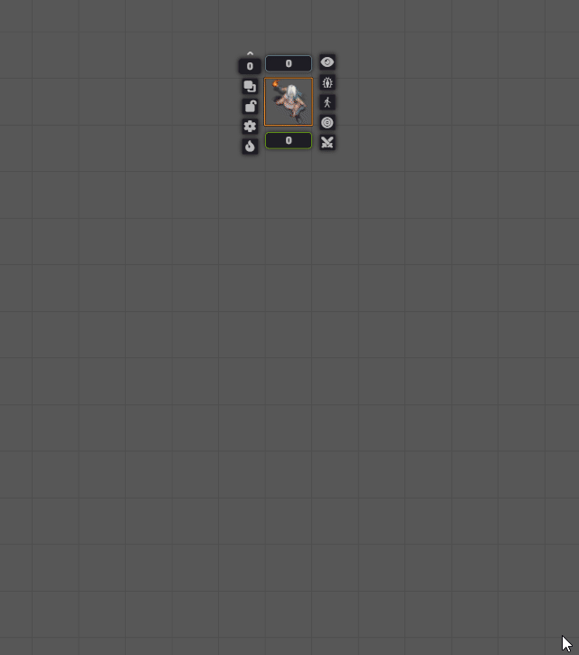
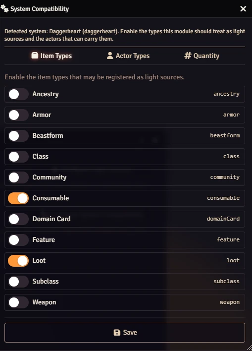
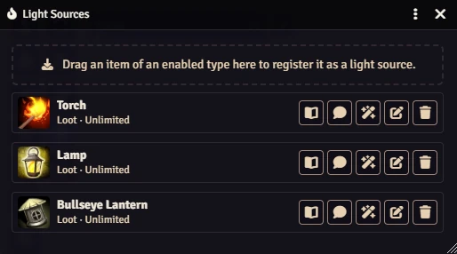
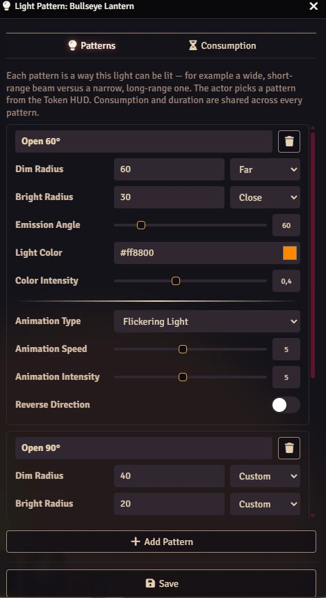
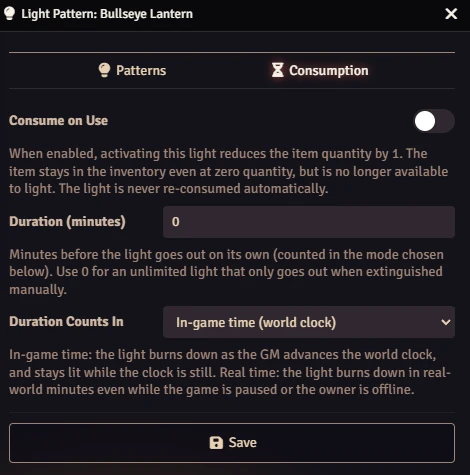
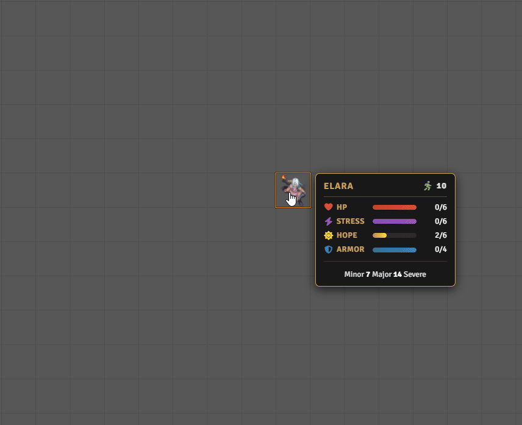
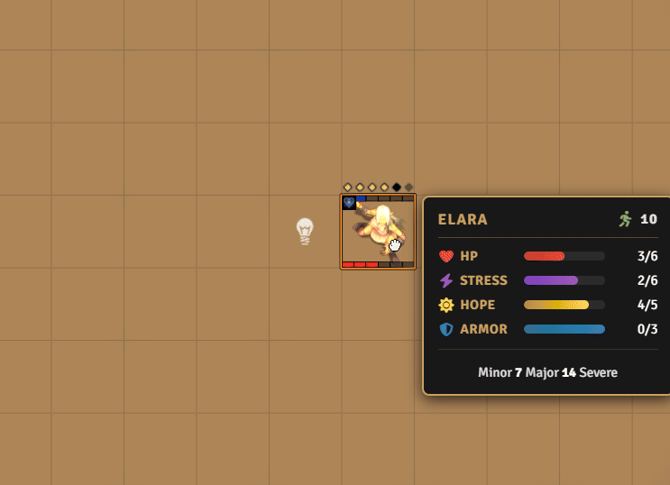
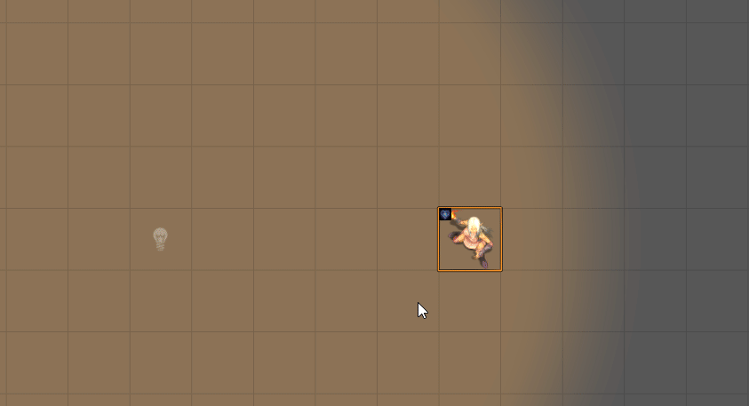

# Light Sources

**Your characters carry torches, candles and lanterns. This module makes them actually light the way — in any system.**



[](https://buymeacoffee.com/mestredigital) [](https://mestredigital.online/pages/projetos-en)

Turn any item in a character's backpack into a real light source. One click on the token, and the darkness pulls back.

## 🕯️ Why?

The party walks into a pitch-black crypt. Someone says *"I light my torch."*

And then the table stops. The GM alt-tabs to the token settings, types a dim radius, types a bright radius, picks a color, picks an animation, closes the window... and by the time the light finally shows up on the map, the moment is gone. Later, nobody remembers to cross the torch off the character sheet, and nobody remembers when it should burn out.

**Light Sources fixes that.** The torch is already in the character's inventory, so lighting it is a single click on the token — the light appears instantly, the item is spent from the sheet, and the flame burns out on its own when its time is up. Darkness stops being paperwork and goes back to being a resource your players have to manage.

## ✨ Key Features

* 🔦 **One-click lighting.** Select a token, click the flame button on the Token HUD, and pick from the light sources available to that character. That's it.
* 🎒 **Uses the real inventory.** Only items the character actually owns show up (plus any "Free for All" sources the GM has enabled — see below). Lighting a torch can subtract it from the sheet, so a torch you burn is a torch you no longer have. A lantern that isn't used up belongs to the item that burns: if it leaves the sheet while lit (deleted, given to another character, carried off by another module), its light goes out with it — unless the system or module moving it hands the light along.
* ⏳ **Lights burn out on their own.** Give a source a duration and it goes out by itself when the time runs out — with a message in chat announcing it. No timers to babysit. Pick how each source counts down: **in-game time** (it burns as the GM advances the world clock — three real hours of chatter won't waste a torch) or **real time** (it burns in real-world minutes even while the game is paused or the player is offline). Hover the flame button on the Token HUD to see what's burning and how much of it is left — no clutter on the map, just the number when you ask for it. A light that spends charges doesn't waste them either: put out a lantern halfway through its oil, and the next time it's lit it burns what it had left before spending another charge.
* 📉 **Lights that gutter before they die.** Give a pattern a second, **running-low** look — smaller, redder, flickering harder — and set how many minutes before the end it kicks in. In those last minutes the light switches to it on its own, in hand or on the ground, so the table sees the torch dying before it goes out. Rewind the clock and the full flame comes back.
* 🎨 **A look for every flame.** Each source gets its own light pattern: radius, angle, color, brightness and animation. A candle should feel nothing like a bullseye lantern, and here it doesn't.
* 🌑 **Darkness, too.** Tick **Darkness Source** on a pattern and it sheds darkness instead of light — the area inside its radius gets dimmer, not brighter. Everything else works the same: it burns down, it can be dropped, it can be picked back up. A single item can even carry one light pattern and one darkness pattern side by side.
* 🔀 **Multiple patterns per source.** A single item can have more than one way to shine. A lantern might have a "Low" mode with a soft glow and a "High" mode that fills the room — both appear in the Token HUD, and the player just picks the one they want. Switching between them is free: it reshapes the flame that's already burning, so it never spends a second item and never restarts the countdown.
* 👀 **See it before you save it.** While you edit a light pattern, the change is previewed live on the selected token. Tweak until it looks right — nothing is written until you hit Save.
* 🆓 **Free-for-all lights.** Mark a light source as "Free for All" and every character of an actor type you've enabled can use it, even if they don't carry the item — perfect for magical environmental effects, a bonfire everyone sits around, or a glowing aura that doesn't cost inventory. Regular, item-based sources are never restricted this way: carrying the item is always enough, regardless of actor type.
* ✍️ **Register without an item.** No physical item yet, or want a source that exists by name alone? Click **Add by Name** in the config window to register one instantly — pairs naturally with Free for All. If you mistype the name, you can fix it later in the source's editor.
* 🪔 **Drop a light on the ground.** Light a source, then drop it — the burning light leaves your token and becomes an Ambient Light placed on the map at your token's feet. Walk away, and the torch stays behind on the floor, still burning down: leave it long enough and you'll come back to a torch that has gone out. Dropping costs nothing extra: it puts down the light you already lit. Works even for players; the module relays the request to the GM.
* 🤲 **Pick it back up.** Changed your mind, or just came back for it? Walk a token onto the light you left behind — or onto any square beside it — and **Pick Up Light** appears in the flame menu. The torch returns to your hand still lit, carrying only the time it hasn't burned yet. Nothing is spent, because nothing needs to be: it's the same flame you put down, not a fresh torch off the sheet.
* 🫥 **Pocket a light without losing it.** Some lights aren't flames to be snuffed — a Light spell cast on a pebble is *covered*, not put out. Mark a source **Can Be Covered** and its lit row grows a **Stow** button beside Drop: the light stops shining but goes on burning down in the character's pocket, and **Uncover** brings it back with the time it has left. Extinguishing is still there for when the spell really should end. Torches and lanterns are untouched — they only get this if you ask for it.
* 💡 **Lights the players can switch.** Tick **Players Can Switch** on any light in the scene's own light configuration and a control appears over it on the map, much like a door's. Players walk a token up to the light and click to snuff it or light it again — a corridor of torches stops being scenery and becomes something a stealthy party can do something about. Lights a player dropped are theirs to work from the start, no GM tick required.
* 🧩 **Works with any system.** Tell the module which item types are light sources, which actor types can use Free-for-All ones, and where an item's quantity lives — then it just works. Daggerheart comes preconfigured out of the box.
* 📏 **Handy presets.** The radius and duration fields come with dropdown presets (10, 15, 20, 30, 60) so you can size a light — or a burn time — in a click instead of typing. Pick **Custom** whenever you want an exact value instead.
* 🗺️ **The light follows the character.** It stays with them across scenes, and blowing it out restores exactly the token lighting they had before.
* 💬 **Chat announcements.** Lighting a source, dropping it on the ground, picking it back up and burning out each post a styled chat card, so the table always knows who has light and who just lost it. Switching between a source's own patterns stays quiet — that's the same flame reshaped, not a new one. Lighting announcements can be turned off entirely in the world settings if your table finds them noisy. You can also send any registered light source to chat as a draggable card — drop it on an actor sheet to add it to their inventory.
* 📦 **Take your setup to another world.** Export your light sources and compatibility settings to a file, and import them in your next campaign — see [below](#for-the-gm--copy-your-setup-to-another-world).
* 🔒 **GM-only mode.** A world setting locks the Token HUD's light controls to the GM alone — players still see what's lit, but activating, extinguishing, dropping and picking up sources becomes the GM's call.
* 🔌 **Developer API.** Module and system developers can [programmatically register light sources](docs/register-sources-api.md) from their own code — no manual drag-and-drop needed. Registered sources merge seamlessly with the GM's hand-picked ones. They can also **light a source from code**, for lights whose cost isn't an item — a spell slot, a fatigue token, anything only the system knows how to charge — and keep such a source **out of the Token HUD**, so the light only ever comes through the system's own cast. A module that moves items between sheets and the map, such as loot, can **carry a lit lantern to the ground and back** with its item, and a system that gives items from one character to another can **hand the light over** with the item, so a lit torch arrives lit.

## 🛠️ How to Use

### For the GM — set it up once

1. Open **Game Settings → Configure Settings → Light Sources → Configure System Compatibility**. Enable the **item types** that count as light sources, the **actor types** allowed to use Free-for-All sources (actors carrying the item can always light it, no matter their type), and enter the **item quantity path** (where your system stores an item's quantity, e.g. `system.quantity`) — plus, for items with uses, the **charges path** (e.g. `system.uses.value`). On Daggerheart this is already filled in for you.

   

2. Open **Configure Light Sources** and drag any item of an enabled type from a compendium or the sidebar into the window to register it — or click **Add by Name** to register a source with just a name, no item required (handy for Free-for-All grants, or for sources you want to set up before the item exists).

   A source made from an item shows that item's name and icon. To rename the source, rename the item, and the source follows.

   

3. Click the ✏️ pencil on any entry to shape it:
   * **Item Name** appears only on a source added by name. It is the exact name an item must have in a character's inventory to count as this light, so changing it changes which items match. Two sources can't share a name.
   * **Patterns** — add one or more light patterns for the same item (different radii, colors, animations). A lone pattern needs no name; add a second and each gets its own label in the HUD. Tick **Darkness Source** on a pattern to make it shed darkness instead of light; the animation list swaps to Foundry's darkness animations when you do. Open **Running Low** on a pattern and tick **Use a Running Low Look** to give it a second look — its own radii, color and animation — for its last minutes. Click into that section and the token previews the running-low look; click anywhere else in the card and it previews the full one.

     

   * **Consumption** — what lighting it spends: nothing, one from a stack, or one charge of the item itself — a light that spends a charge burns on the item, so it goes out when the item leaves the character and travels with it when a module such as Canvas Loot drops it on the map or a system hands it to another character, and put out before it burns down it keeps the time it had left for the next lighting instead of spending another charge — how many minutes it burns before dying out (`0` = burns forever until put out by hand), and whether that countdown runs on the **in-game clock** or on **real time**. **Running Low Phase** sets how many of those last minutes every pattern shows its running-low look (`0` = off). Saving applies it to lights that are already burning.

     

   * **Can Be Covered** — on the same tab: whether this light can be stowed instead of extinguished (see below). Off by default.
   * **Can Be Dropped** — also on that tab: whether the Token HUD offers **Drop** while this light burns. On by default. Turn it off for a light built into what the character wears, such as glowing armor or a lamp fixed to a helmet: it stays on the token, and still leaves together with its item when a module carries that item off.

Optional per-source toggles on the config window:
* **Free for All** — when enabled, every actor of an enabled Actor Type can light this source without carrying the item.
* **Hide from Token HUD** — the source never shows in the flame menu while it's unlit, so it can only be lit by a system or module through the API (see [For Developers](#-for-developers)). Once lit it appears as usual, with its Extinguish control, until it goes out. Meant for spell lights whose real cost the system charges before the light exists.
* **Send to Chat** — posts a draggable item card that can be dropped onto actor sheets.
* **Duplicate** makes a copy of the source to start a new one from, with the same patterns, consumption and duration. The copy is always a source added by name, even when the original came from an item, and it is called "Lantern (Copy)" for a source named Lantern. It matches no item until you give it a name, so its editor opens as soon as you click. **Free for All** and **Hide from Token HUD** start off on the copy.

There are also a few world settings under **Game Settings → Configure Settings → Light Sources**:
* **Allow Dropping Free for All Lights** (on by default) — whether a lit Free-for-All light can be dropped on the ground. No item backs these sources, so dropping one costs nothing and can be repeated without limit; turn this off if you'd rather free lights stayed on tokens. A source whose **Can Be Dropped** is off is never droppable, whatever this setting says.
* **Restrict Light Control to the GM** (off by default) — when enabled, only the GM can activate, extinguish, drop or pick up a light source from the Token HUD. Players still see the flame menu and what's currently lit, but their clicks on those controls are refused.
* **Announce Lights in Chat** (on by default) — turn off to stop lighting a source from posting the "lights it" chat card. Dropping, picking up and burning out keep announcing regardless.

Tip: select a token on the canvas while you edit — you'll watch the light change on the map in real time.

### For the GM — give a light to only one character

A light source shows in a character's Token HUD when it is marked **Free for All**, or when the character carries an item with the same name as the source. Your game system doesn't need to know anything about light sources for this to work: a plain item called "Lantern" is enough.

To make the Lantern belong to one character:

1. In **Configure Light Sources**, turn **Free for All** off on the Lantern.
2. Create an item named exactly "Lantern" and give it to that character. Any item type works, unless the source is tied to a specific item type. Then the item has to be of that type too.
3. If the item isn't meant to be used up, open the source with the pencil and set **Lighting Spends** to **Nothing**.

Now only that character sees the Lantern in the flame menu. To hand it to someone else, move the item to their sheet. Sources everyone should always have, such as torches, can stay on **Free for All**.

### For the GM — copy your setup to another world

Open **Import or Export Light Sources** in the module settings. **Export to File** saves a JSON file holding:

* every light source you added — dragged items and the ones added by name;
* your edits to sources that a module or game system provides, and the ones of those you removed;
* the System Compatibility settings (item types, actor types, quantity and charges paths).

Sources a module provides are not in the file as such: they come back in any world where that module is active, and your edits to them apply there again.

In the other world, choose the file and click **Import from File**. You see what will change before anything is written. A source in the file replaces the one with the same item, and the sources already there are kept. The compatibility settings are applied only when both worlds use the same game system.

A source made from an item in a world's Items directory points to an item that the other world doesn't have. It is imported anyway, and the import lists it: it still works for any carried item with the same name and type, but **Open Item** and **Send to Chat** can't find it. To link it again, drag the matching item into **Configure Light Sources**; the source keeps its patterns and settings. For a setup that moves cleanly between worlds, drag your light items from a compendium.

### For the GM — hand a light over to the players

Any light already placed on your scene can be made interactive. Open it on the **Lighting** layer to bring up Foundry's own light configuration, and tick **Players Can Switch** at the bottom of the **Basic** tab.

From then on a small control appears over that light for everyone who can see it. On a scene with several levels, it shows only while one of the light's own levels is being viewed. A player has to walk a token onto the light — or onto a square beside it, on the light's level — before the control responds, so putting out the torch at the end of the hall means walking down the hall. This is what makes it a stealth decision rather than a free action.

A light that is switched off uses Foundry's native **hidden** state, so you'll see it dashed on the Lighting layer while it's out, and you can always flip it back yourself. Lights the players drop on the ground get this treatment automatically — those are theirs, and need no tick from you.

### For the players — light it up

1. Make sure the item (a Torch, a Lantern...) is in your character's inventory — however your system normally hands out items. (Skip this if the GM marked the source "Free for All" and your character's type is eligible — then it's available automatically.)
2. Click your token on the map to bring up the Token HUD.
3. Click the 🔥 **flame button** and choose your light source. If the source has multiple patterns, each one shows as a separate option.
4. Done — your token is now lighting the room, and the table sees it in chat.

While something is burning, the flame button glows. Hover it to check what's lit and how many minutes it has left.


To put it out, open the same menu and click **Extinguish Light**. If it burns out on its own first, everyone sees it happen in chat.

If the source spends a charge each time it's lit — a lantern and its oil, say — putting it out early doesn't waste that charge. The time it had left stays with the item, and the next time you light it, it picks up where it stopped without spending another charge — hover its entry in the flame menu to see how much is left. Once that time runs out, the next lighting spends a fresh charge as usual.

A lantern can also burn fuel from another item, such as a stack of oil flasks. In the light editor, set **Lighting Spends** to **Fuel from another item** and drag the oil onto the **Fuel** field. The lantern is the light and is never spent. Each lighting spends one oil flask, and with no oil left the lantern can't be lit. Put it out early and the time it had left stays on the lantern, so the next lighting burns that first without spending more oil.

**Drop a light**: once a light is burning, a **Drop** button appears next to it in the flame menu. Click it to put that light on the ground as an Ambient Light — useful for torches left behind in a hallway or campfires. Your token goes dark and the light stays where you dropped it — on the same level (floor) as your token, at its elevation, so a torch dropped upstairs doesn't light the cellar. Nothing extra is consumed: you're putting down the light you already lit, not spending a second torch.



**Pick a light back up**: walk back to a torch you left on the floor and select your token. If it's standing on the light — or on any of the squares around it — and on the same level (floor) as the light, **Pick Up Light** appears at the top of the flame menu. Click it and the flame comes back to your token with the time it has left on it. Like dropping, this costs nothing: you're picking up the torch you put down, not spending a new one.



Do come back for it, though. A torch on the floor is still burning, and if you leave it too long you'll return to find it has gone out.

**Stow a light**: if the GM marked the source **Can Be Covered**, a **Stow** button sits beside Drop on the light you're carrying. Click it and the light goes dark without going out — it keeps burning down in your pocket, the flame button stays marked, and hovering it still tells you how long is left. Click **Uncover** to take it back out. This is what you want for a spell cast on an object: **Extinguish** ends the spell for good, stowing does not.

One thing worth knowing: your character carries one light at a time. Lighting something else replaces the stowed one and the spell is gone with it. If you want to keep it alive while you carry a torch, **drop** it instead — on the floor it goes on burning down, covered exactly as you left it, and anyone can pick it back up.

**Switch a light on or off**: some lights on the map can be worked directly — any torch you dropped yourself, plus any scenery light your GM has opened up. Those show a small light control on the map. Move your token onto the light or next to it and click the control to snuff it or light it again. From further away the control stays faded and clicking it just tells you to get closer: you can only put out a light you've actually reached.



## 🔌 For Developers

If you maintain a game system or a companion module and want to ship pre-configured light sources, you can use the **Register Sources API** to add them with code — no GM setup needed.

👉 **[Read the full API documentation](docs/register-sources-api.md)**

Quick taste:

```js
Hooks.once("ready", async () => {
  await game.lightSources?.registerSources([
    {
      uuid: "Compendium.my-system.equipment.Item.torch01",
      patterns: [
        { id: "lit", light: { dim: 40, bright: 20, color: "#ff8800", animation: { type: "torch", speed: 5, intensity: 5 } } }
      ],
      consume: "copy",
      durationMode: "world",
      durationMinutes: 60
    }
  ], { managedBy: "my-system" });
});
```

Registered sources appear in the Token HUD and in the GM's configuration window with a badge showing which module manages them.

The same API can **light a registered source from code** — `game.lightSources.activate(actor, uuid)` — with the same consumption, duration and chat announcement a Token HUD click would have, plus `deactivate(actor)` and `getActive(actor)`. Pair it with the **Hide from Token HUD** toggle (or `hudHidden: true` when registering) for a light whose cost is a spell slot or similar: the system charges it, then lights it, and the player can't skip the charge from the palette.

A module that carries items off a sheet and onto the map can take a lit light along with the item: `dropLightWithItem(item, where)` places the light where the item lands, and `pickupGroundLight(item, light)` hands it back with the burn time it had left. See [the API docs](docs/register-sources-api.md#droplightwithitemitem-where).

A system that gives items from one character to another — a trade, a drag between sheets — can take the light along the same way: create the copy on the receiver, call `handOverLight(original, copy)`, then remove the original. The light moves across with the time it had left, and nothing is spent. See [the API docs](docs/register-sources-api.md#handoverlightfromitem-toitem).

Registered values are **defaults, not locks**: once the GM edits one of these sources, the GM's version is kept and the module's values no longer apply to it, and a **Restore Module Default** control puts them back — either for the whole source, or for a single light pattern. A source the GM removes stays removed until it is restored. Registered sources are not stored in the world: the module that provides them registers them again each session. See the [Register Sources API docs](docs/register-sources-api.md#gm-customization-important) for the full contract.

## 🚀 Installation

Install via the Foundry VTT Module browser or use this manifest link:

```
https://github.com/brunocalado/light-sources/releases/latest/download/module.json
```

## 🌍 Translations

Want to translate this module? It's easy:
1. Download the `languages/en.json` file.
2. Translate the values in the JSON file.
3. Open an issue on [GitHub](https://github.com/brunocalado/light-sources/issues).
4. Attach your translated file and tell us the `lang` and `name` it should use. For example:
   ```json
   "lang": "en",
   "name": "English"
   ```
   or
   ```json
   "lang": "pt-BR",
   "name": "Portuguese (Brasil)"
   ```

## ⚖️ Credits

* **Code License:** GNU GPLv3.

* **Italian translation:** [GregoryWarn](https://github.com/GregoryWarn) ([#8](https://github.com/brunocalado/light-sources/pull/8)).

* [thumbnail/banner](https://unsplash.com/license)